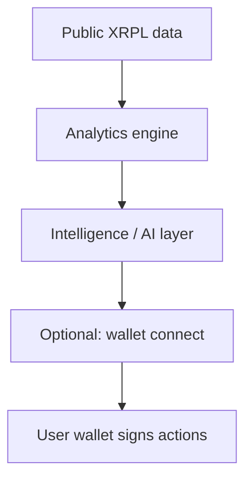

# XRPL-OS — System Architecture

**Repository:** [Shellfish011235/xrpl-os](https://github.com/Shellfish011235/xrpl-os)  
**Companion:** [STRATEGY.md](./STRATEGY.md) (product doctrine and risk framing)

This describes **intended** data flow and **trust boundaries**. The live app may implement only a subset (today: **read-only** mainnet streaming + illustrated upper layers).

---

## End-to-end flow (target)

| Stage | Role |
|-------|------|
| **Public XRPL data** | Validated ledgers, transactions, metadata — **no user secrets**. |
| **Analytics engine** | Derives metrics, views, and classifications from public (and later user-consented) data. |
| **Intelligence / AI** | Suggestions, explanations, simulation — **not** custody or signing. |
| **Wallet connect (optional, future)** | User-owned keys; read-only or propose-then-sign patterns. |
| **User wallet signs** | **Only** place end-user value movement is authorized — explicit signatures, not hidden backend execution. |

---

## Trust boundary (non-negotiable in design)

> **Anything that moves value** must be **structurally** behind the user’s wallet and explicit approval — not a “toggle,” but a separation of **read/analyze** vs **sign/execute**.

The in-app **System architecture** modal summarizes this in the UI for demos and onboarding.

---

## UI layers (left panel of the app)

The four layers are a **mental model** for how XRPL-OS is discussed and built:

| Layer | Label (conceptual) | Typical content |
|-------|--------------------|-----------------|
| **L0** | Kernel of value (XRPL) | Consensus, DEX, escrow, NFTs, AMM — **LIVE** public network in the current demo |
| **L1** | Accounting | Double-entry, batching — may be productized later (e.g. TigerBeetle-style patterns) — **not** the same as “we operate a bank ledger” |
| **L2** | Network / ILP | Interledger, connectors — **roadmap / simulation** in the shell today |
| **L3** | Agent runtime | DIDs, tasks, automation — **roadmap / simulation**; real agents require policy + approval design |

L1–L2–L3 are **not** all live in the current open-source build; see [STRATEGY.md](./STRATEGY.md) for honest **current vs future** status.

---

## Technology notes (this repository)

- **Client:** React + Vite.  
- **L0 live stream:** WebSocket subscription to a public rippled endpoint (e.g. `wss://s1.ripple.com`) for `transactions` and `ledger` streams — **read-only** from the app’s perspective.  
- **No server component** in this repo is required for that observation path; **do not** send private keys to any service you do not fully control and secure.

---

## Versioning

Update this file when you add real wallet connect, a backend, or any path that could sign or move funds — those changes **must** be reflected here and in [STRATEGY.md](./STRATEGY.md).
